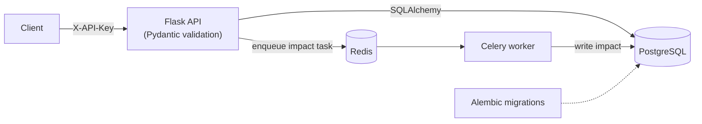

# disruption-api

[](https://github.com/1lauraog15-cloud/disruption-api/actions/workflows/ci.yml)

REST API to track flight disruptions (delays, cancellations, diversions) the way an airline
operations control centre would. **All data is synthetic.** It is a backend practice project:
Flask, SQLAlchemy 2.0, PostgreSQL, Alembic, Pydantic v2, Celery/Redis, pytest, Docker and GitHub Actions.

Interactive documentation is served at `/docs` (Swagger UI) from the machine-readable spec at `/openapi.json`.

## Architecture



1. A client records a disruption with `POST /disruptions`. The API validates it, stores it and answers `202`.
2. A Celery task estimates the impact (affected connections and a score) and writes it back to the row.
3. If the delayed flight has a `tail_number`, the same task follows that aircraft's later flights and records knock-on delays (see below).
4. Clients read the result with `GET /disruptions/<id>`, the knock-ons with `GET /disruptions/<id>/cascade`, and aggregated delays at `/stats/delays`.

## Knock-on delays along an aircraft rotation

Flights that share a `tail_number` form that aircraft's rotation (a flight with a tail number must also give `scheduled_arrival`). When a flight is delayed, each later leg absorbs part of the delay with its slack, meaning ground time beyond a 45-minute minimum turnaround, and passes the rest on. The chain stops at the first leg that absorbs everything. For example, a 60-minute delay on a rotation with 15 minutes of slack per leg becomes 45 minutes on the next flight and 30 on the one after. Each knock-on is stored as its own disruption with `parent_id` pointing at the original, gets its own impact estimate, and is created once (a task retry does not duplicate it).

## Endpoints

| Method | Path | Purpose |
|---|---|---|
| GET | `/health` | liveness (public) |
| GET | `/health/ready` | readiness: `200` if the database answers, `503` otherwise (public) |
| GET | `/docs`, `/openapi.json` | Swagger UI and OpenAPI spec (public) |
| POST | `/airports` | register an airport (`iata`, `name`, `is_hub`) |
| POST | `/flights` | create a flight (optional `tail_number` and `scheduled_arrival`) |
| GET | `/flights/<id>` | read a flight |
| POST | `/disruptions` | record a disruption; returns `202` and queues the impact calculation |
| GET | `/disruptions?status=&kind=&limit=&offset=` | list, filter and paginate (`limit` 1-200, default 50); returns `{items, total, limit, offset}` |
| GET | `/disruptions/<id>` | read one |
| GET | `/disruptions/<id>/cascade` | knock-on delays on later flights of the same aircraft |
| PATCH | `/disruptions/<id>/resolve` | mark as resolved |
| POST | `/disruptions/<id>/actions` | log a recovery action (rebooking, crew swap...) |
| GET | `/stats/delays` | median and p90 delay per origin airport (pandas) |

Everything except the public endpoints requires an `X-API-Key` header (`401` otherwise). Only SHA-256
hashes of keys are configured, in `API_KEY_HASHES`. Other errors are JSON: `422` invalid input, `404` missing
resource, `409` conflict, `503` database unavailable.

## Quick start

```bash
cp .env.example .env
python -m disruption_api.auth      # prints a new key and its hash
# put the hash in API_KEY_HASHES (in .env), then:
docker compose up --build
docker compose exec api alembic upgrade head
```

```bash
KEY=<the key printed above>
curl -s -H "X-API-Key: $KEY" -X POST localhost:8000/airports \
  -H 'Content-Type: application/json' -d '{"iata":"BCN","name":"Barcelona"}'
curl -s -H "X-API-Key: $KEY" -X POST localhost:8000/airports \
  -H 'Content-Type: application/json' -d '{"iata":"MAD","name":"Madrid","is_hub":true}'
curl -s -H "X-API-Key: $KEY" -X POST localhost:8000/flights \
  -H 'Content-Type: application/json' \
  -d '{"number":"XY123","origin":"BCN","destination":"MAD","scheduled_departure":"2026-11-01T08:30:00+00:00","passengers":180}'
curl -s -H "X-API-Key: $KEY" -X POST localhost:8000/disruptions \
  -H 'Content-Type: application/json' \
  -d '{"flight_id":1,"kind":"delay","delay_minutes":90,"reason":"weather"}'
curl -s -H "X-API-Key: $KEY" "localhost:8000/disruptions?status=open&limit=10"
```

## Project layout

- `disruption_api/models.py`: SQLAlchemy models with constraints and indexes.
- `disruption_api/schemas.py`: Pydantic models for input and output.
- `disruption_api/routes.py`: Flask blueprint, one database session per request.
- `disruption_api/services.py`: business logic (impact estimate, statistics), no HTTP.
- `disruption_api/tasks.py`: Celery task that fills `affected_connections` and `impact_score`.
- `disruption_api/auth.py`: API key hashing and constant-time verification.
- `disruption_api/openapi.py`: OpenAPI spec and Swagger UI.
- `migrations/`: Alembic migrations (`0001` airports/flights, `0002` disruptions, `0003` impact columns and index, `0004` aircraft rotation and `parent_id`).

## Develop and test

```bash
python -m venv .venv && . .venv/bin/activate
pip install -r requirements.txt pytest pytest-cov ruff mypy pandas-stubs
ruff check . && ruff format --check . && mypy && pytest
```

By default tests use in-memory SQLite and a mocked Celery `.delay`, so they need no services. Set
`TEST_DATABASE_URL` to run the same suite on PostgreSQL. CI runs both, applies the migrations up, down and up
again on PostgreSQL, checks that the OpenAPI spec lists exactly the routes the app serves, and builds the
Docker image.

## Configuration

Everything comes from environment variables (`DATABASE_URL`, `CELERY_BROKER_URL`, `CELERY_RESULT_BACKEND`,
`API_KEY_HASHES`); see `.env.example`. No secrets are committed.

## Limits

Only delays cascade (a cancellation or diversion does not re-plan the rotation), and the 45-minute turnaround is a fixed assumption. The impact estimate uses simple, documented assumptions (share of connecting passengers, severity by type and
delay) and is not a real operations model. Authentication is one static key per client, with no roles or rate
limiting.
